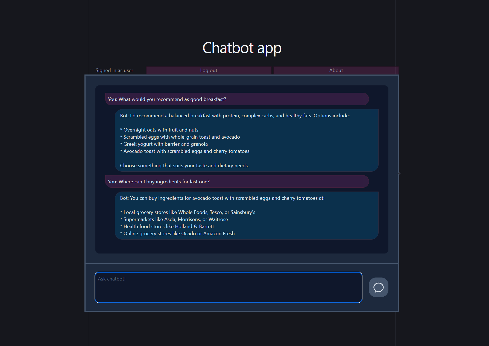
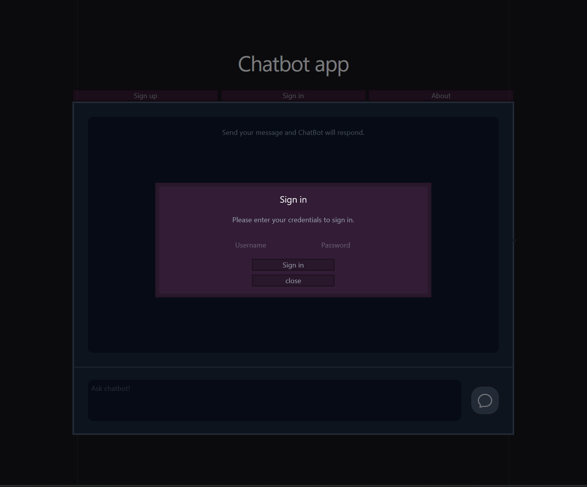
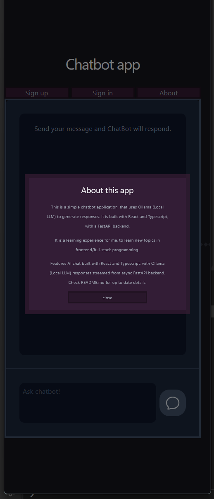

# Full Stack AI Chat

Full-stack AI chat application.
Playground for learning and improving my frontend/fullstack skills.

## Stack

- Frontend: javascript with react, typescript, vite
- Backend: Python, fastapi, Ollama for running local ai model
- Ollama3.2 model

## Features

- AI Chat, where you can talk with AI LLM (provided by local model with Ollama3.2), and model keeps track of current conversation in memory.
- Chat utilizes HTTP streaming for fluent response display
- Authentication with JWT, blacklisting tokens.
- Typing with typescript and type hints for both backend and frontend
- Files cleanly divided into specific modules and areas in frontend and backend
- Uses repository and service layer for code structure
- Frontend responsiveness through scaling html elements size as screen width decreases (clamp)- visible site elements keep reasonable size with lower screen sizes (until some minimal size)

## Running
Create `.env` file based on `example.env` in project root.
Run commands:
docker compose up --build --watch
docker compose exec -it backend uv run alembic upgrade head
Launch [website in http://localhost:5173/](http://localhost:5173/)

## Running tests
Run main application, then run:
`docker compose exec -it backend uv run -m pytest`

To debug tests and if you are using vscode, run:
`docker compose exec -it backend uv run debugpy --wait-for-client --listen 0.0.0.0:5679 -m pytest`
then Run `Remote debug pytest tests` run config in vscode, or it's command manually, by checking .vscode/launch.json run config directly
